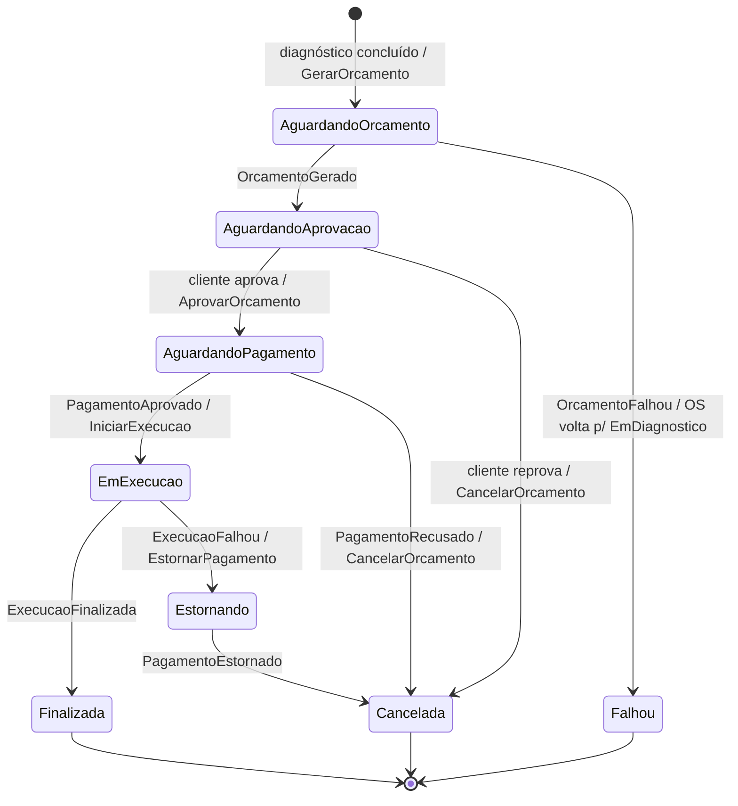

# Fase 4 — Contratos de mensageria e convenções entre microsserviços

Fonte da verdade dos contratos trocados via RabbitMQ entre os três serviços. Qualquer mudança aqui
precisa ser replicada no arquivo `Contracts/Mensagens.cs` de **cada** repositório (não há pacote
NuGet compartilhado de propósito: cada serviço é dono do seu deploy, e o contrato é pequeno).

| Serviço | Repositório | Banco | Papel na Saga |
|---|---|---|---|
| OS Service | `konrath9/OficinaMecanica` | PostgreSQL (RDS, database `oficina_mecanica`) | **Orquestrador** (MassTransit StateMachine) |
| Billing Service | `konrath9/oficina-billing-service` | PostgreSQL (RDS, database `oficina_billing`) | Participante: orçamento + pagamento (Mercado Pago) |
| Execution Service | `konrath9/oficina-execution-service` | MongoDB (in-cluster, database `oficina_execucao`) | Participante: fila e execução da OS |

## Transporte

- **MassTransit 8.x** (Apache 2.0 — a v9 é comercial, não usar) sobre **RabbitMQ**.
- Todas as mensagens são **publicadas** (`IPublishEndpoint.Publish`) — inclusive os comandos. Cada serviço
  registra seus consumers e chama `cfg.ConfigureEndpoints(context)` com
  `SetKebabCaseEndpointNameFormatter()`. Sem endereços hard-coded entre serviços.
- O nome da mensagem no broker é derivado de `namespace + nome do tipo` (`urn:message:OficinaMecanica.Contracts:GerarOrcamento`),
  por isso o **namespace precisa ser exatamente `OficinaMecanica.Contracts`** e os nomes dos tipos/propriedades idênticos nos três repos.
- Correlação: `OrdemServicoId` (Guid) é o `CorrelationId` da saga em todas as mensagens.
- Consumers devem ser **idempotentes** por `OrdemServicoId` (o broker entrega "at least once").
- Retry: `cfg.UseMessageRetry(r => r.Interval(3, TimeSpan.FromSeconds(2)))`. Esgotadas as tentativas, a mensagem vai para a fila `_error`.

Configuração (env vars / appsettings):

```
RabbitMq__Host=rabbitmq          # Service do k8s (namespace oficina-mecanica); localhost no dev
RabbitMq__Username=oficina
RabbitMq__Password=oficina123    # demo; em produção vem de Secret
```

## Contratos (copiar como `Contracts/Mensagens.cs`)

```csharp
namespace OficinaMecanica.Contracts;

// ---------- OS Service -> Billing Service (comandos) ----------
public record ItemOrcamento(string Descricao, string Tipo, int Quantidade, decimal PrecoUnitario); // Tipo: "Servico" | "Peca"

public record GerarOrcamento(Guid OrdemServicoId, string NumeroOs, Guid ClienteId, string? EmailCliente,
    IReadOnlyList<ItemOrcamento> Itens, decimal Valor);
public record AprovarOrcamento(Guid OrdemServicoId);                 // cliente aprovou -> Billing cria a cobrança
public record CancelarOrcamento(Guid OrdemServicoId, string Motivo); // compensação
public record EstornarPagamento(Guid OrdemServicoId, string Motivo); // compensação

// ---------- Billing Service -> OS Service (eventos) ----------
public record OrcamentoGerado(Guid OrdemServicoId, Guid OrcamentoId, decimal Valor);
public record OrcamentoFalhou(Guid OrdemServicoId, string Motivo);
public record PagamentoCriado(Guid OrdemServicoId, Guid PagamentoId, string? LinkPagamento);
public record PagamentoAprovado(Guid OrdemServicoId, Guid PagamentoId, decimal Valor);
public record PagamentoRecusado(Guid OrdemServicoId, Guid PagamentoId, string Motivo);
public record PagamentoEstornado(Guid OrdemServicoId, Guid PagamentoId);

// ---------- OS Service -> Execution Service (comandos) ----------
public record ServicoExecucao(Guid ServicoId, string Descricao, int Quantidade);

public record IniciarExecucao(Guid OrdemServicoId, string NumeroOs, IReadOnlyList<ServicoExecucao> Servicos);
public record CancelarExecucao(Guid OrdemServicoId, string Motivo); // compensação

// ---------- Execution Service -> OS Service (eventos) ----------
public record ExecucaoIniciada(Guid OrdemServicoId);                       // OS entrou na fila de execução
public record ExecucaoFinalizada(Guid OrdemServicoId, DateTime FinalizadaEm);
public record ExecucaoFalhou(Guid OrdemServicoId, string Motivo);
```

## Fluxo da Saga (orquestrada no OS Service)



Responsabilidades de cada participante:

**Billing Service**
- `GerarOrcamento` → cria o `Orcamento` (Pendente) e publica `OrcamentoGerado`. Valor ≤ 0 ou sem itens → `OrcamentoFalhou`.
- `AprovarOrcamento` → marca o orçamento como Aprovado e cria o `Pagamento` (Pendente) no gateway → `PagamentoCriado` (com o link de checkout).
- Confirmação do pagamento: webhook do Mercado Pago (`POST /api/pagamentos/webhook`), que **consulta o pagamento na API do MP** antes de confiar no payload, ou
  `POST /api/pagamentos/{ordemServicoId}/simular` `{ "aprovado": true|false }` (staff — usado com o gateway fake e na demo).
  Resultado → `PagamentoAprovado` ou `PagamentoRecusado`.
- `CancelarOrcamento` → orçamento Cancelado (e pagamento pendente, se houver, Cancelado).
- `EstornarPagamento` → refund no gateway, pagamento Estornado → `PagamentoEstornado`.
- Gateway: `IGatewayPagamento` com `MercadoPagoGateway` (HttpClient → `api.mercadopago.com`, Checkout Pro preference + refund)
  quando `MercadoPago__AccessToken` está configurado; senão `GatewayPagamentoFake`.

**Execution Service**
- `IniciarExecucao` → cria (upsert idempotente) o documento da execução com status `NaFila` → `ExecucaoIniciada`.
- Mecânico conduz pela API: `NaFila → EmDiagnostico → EmReparo`, iniciando/finalizando cada serviço.
  Quando o último serviço é finalizado → status `Finalizada` → `ExecucaoFinalizada`.
- `POST /api/execucoes/{ordemServicoId}/falha` `{ "motivo": "..." }` → status `Falhou` → `ExecucaoFalhou` (dispara o estorno).
- `CancelarExecucao` → status `Cancelada` (se ainda não finalizada).

## Convenções comuns aos três repositórios

- .NET 8, `net8.0`. Estrutura: `<Servico>.Domain` (entidades e regras), `<Servico>.Api` (controllers, consumers, infraestrutura) e `<Servico>.Tests`.
- Auth: JWT Bearer com os mesmos parâmetros do OS Service — `Jwt__SecretKey` / `Jwt__Issuer=OficinaMecanicaAPI` / `Jwt__Audience=OficinaMecanicaClients`.
  Roles: `Administrador`, `Mecanico`, `Recepcionista` (staff) e `Cliente` (claim `sub` = ClienteId).
- Observabilidade: mesmo padrão do OS Service — Serilog JSON + `X-Correlation-Id`, OpenTelemetry → New Relic via OTLP **somente se**
  `NewRelic__LicenseKey` estiver configurado, `.AddSource("MassTransit")` no tracing (trace distribuído entre serviços), `/health`.
- Swagger em `/<prefixo>/swagger` (`billing/swagger`, `execucao/swagger`) para não colidir no Ingress; o OS Service mantém `/swagger`.
- Ingress Traefik, host único: `/api/orcamentos`, `/api/pagamentos`, `/billing` → Billing; `/api/execucoes`, `/execucao` → Execution; o resto → OS.
- Kubernetes: namespace `oficina-mecanica`. O RabbitMQ é declarado em `OficinaMecanica/k8s/rabbitmq.yaml` (orquestrador é o dono); os CIs dos
  outros serviços aplicam esse arquivo direto do GitHub (`raw.githubusercontent.com/konrath9/OficinaMecanica/master/k8s/rabbitmq.yaml`).
- Portas locais: OS 5000, Billing 5001, Execution 5002, RabbitMQ 5672 (UI 15672), Mongo 27017, Postgres OS 5433, Postgres Billing 5434.
- CI/CD (GitHub Actions, por repositório): build → testes com gate de cobertura ≥ 80% (`coverlet.msbuild`, `/p:Threshold=80`) → SonarCloud →
  imagem no GHCR → deploy num cluster `kind` efêmero + smoke test → deploy no k3s de produção via SSH (`K3S_HOST`, `K3S_SSH_PRIVATE_KEY`).
- Branch `main` protegida: PR obrigatório + checks do CI.
